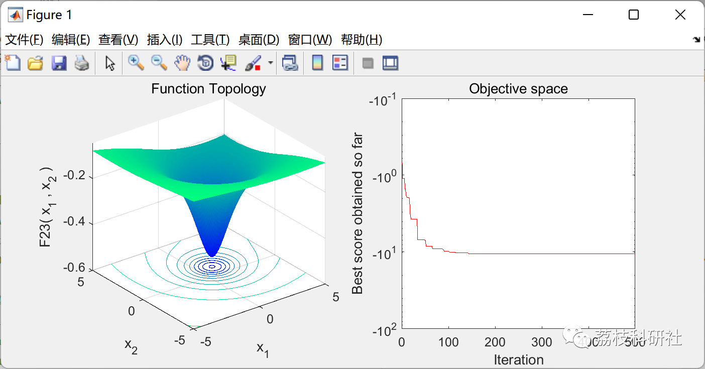

# Ocean Predator Algorithm (Matlab Code Implementation)

💥💥💥💞💞💞💞 Welcome to this blog❤️❤️❤️💥💥💥
🏆 Bloggers' Advantage: 🌞🌞🌞 The content of the blog strives to be rigorous in thought and clear in logic, for the convenience of readers.
⛳️ Mantra: The journey of a hundred miles is half done in the last ninety.
Litchi Research Society
Code Collection: Power System, Intelligent Algorithms and Applications, Neural Network Prediction, Path Planning, Optimized Scheduling, Workshop Scheduling, Image Processing, Signal Processing...
🎁Column Directory Link:
🌈🌈🌈🌟🌟🌟Electrical Code Intelligent Algorithm and Its Application Path Planning Neural Network Predictive Optimization Scheduling Image Processing Workshop Scheduling Signal Processing Romantic Her My Philosophical Thoughts Math Modeling Complete Code Matters
Contents
💥1 Overview
📚2 Running Results
🎉3 References
🌈4 Matlab code implementation
💥1 Overview
The Ocean Predator Algorithm (MPA) is a natural-inspired optimization algorithm that follows the rules of natural dominance in the optimal foraging strategy, and encounters the rate strategy between predators and prey in marine ecosystems.
Mechanism
The MPA optimization process is divided into three main stages, considering different speed ratios while simulating the entire life cycle of predator and prey: (1) at high speed ratios or when the prey moves faster than the predator, (2) at unit speed ratios or when the predator and prey move at nearly the same speed, and (3) when the predator moves faster than the prey. For each defined stage, specific and assigned iteration cycles are specified. These steps are defined according to the rules of the movement nature of predators and prey, while simulating their movements in nature.
📚2 Running Results
🎉3 References
A. Faramarzi, M. Heidarinejad, S. Mirjalili, A.H. Gandomi, Marine Predators Algorithm: A Nature-inspired Metaheuristic Expert Systems with Applications DOI: doi.org/10.1016/j.eswa.2020.113377  
🌈4 Matlab code implementation
Click the "Read More" button at the bottom left of this article to view the complete code.

## Images

<!-- PAYMENT_BLOCK -->

## Get this dataset

- Payment link (Stripe): [Buy now](https://buy.stripe.com/3cs8yP7sY87d0vu9AB)
- Payment QR code: 

<!-- /PAYMENT_BLOCK -->
